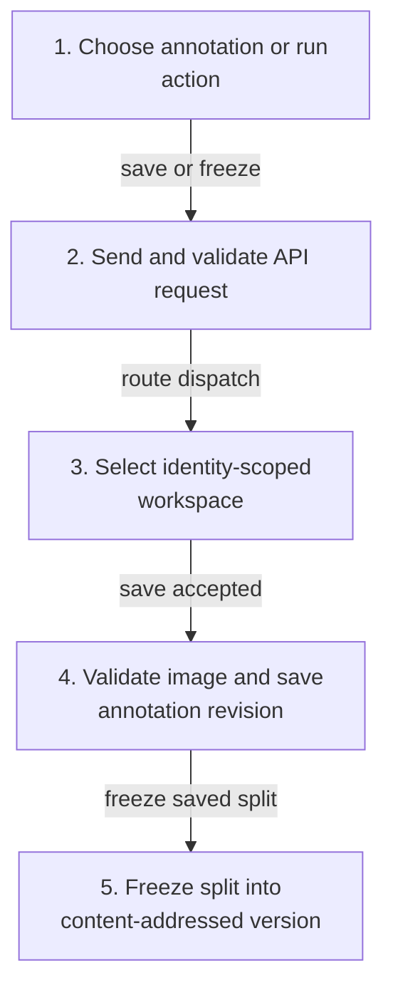
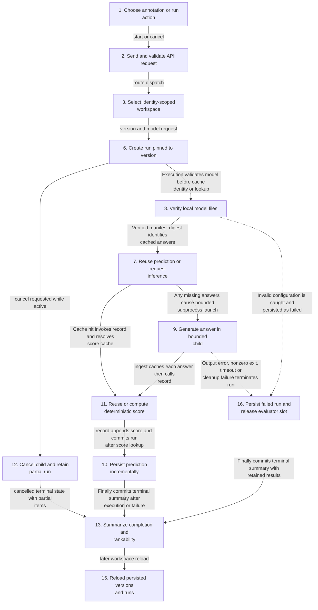
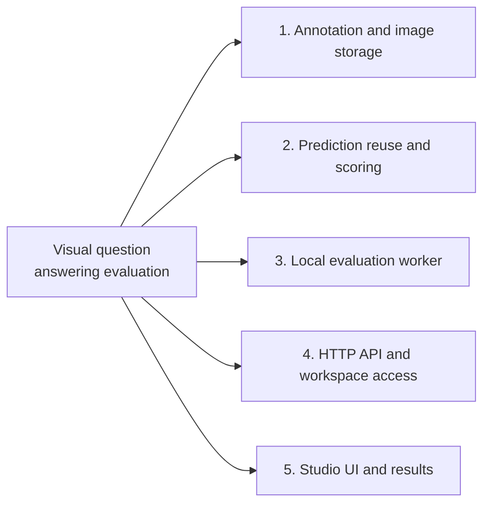
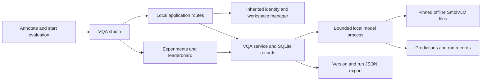
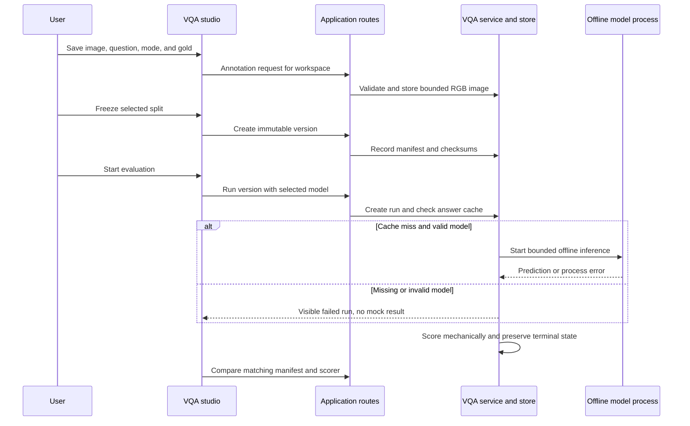

# Visual question answering evaluation

## Architecture and execution guide

<!-- execution-flow:start -->
### Execution flow

Start with the primary path, then expand a detailed workflow. Select a numbered node to see its operation, implementation techniques, and source. Solid arrows show the named control, data, or lifecycle handoff; dotted arrows show error paths. Separate entry points are named in each workflow.

<a id="review-walkthrough"></a>

#### Walk through one concrete example

Run a VQA evaluation against a frozen annotation version using a verified local model.

**Trace.** [Choose annotation or run action](#flow-step-studio-action) → [Create run pinned to version](#flow-step-create-run) → [Verify local model files](#flow-step-model-check) → [Reuse prediction or request inference](#flow-step-answer-cache) → [Generate answer in bounded child](#flow-step-runner-generation) → [Reuse or compute deterministic score](#flow-step-score-cache) → [Persist prediction incrementally](#flow-step-persist-result) → [Summarize completion and rankability](#flow-step-summarize-run) → [Compare eligible runs or export provenance](#flow-step-compare-export).

**Result and boundary.** On a cache miss, the bounded child generates answers, deterministic scores are cached, and results are committed incrementally before the terminal summary. Only completed, fully scored runs are rankable. The current UI scorer label and backend scorer version differ, as documented below.

<details>
<summary>Implementation decisions to explain</summary>

**Why freeze annotations into an immutable manifest instead of evaluating the mutable workspace directly?** Canonical image bytes and captured annotation revisions give a run a stable, reproducible input identity. The tradeoff is that later edits require a new frozen version rather than changing an existing one.

[Validated image canonicalization](#technique-validated-image-canonicalization) · [Revisioned immutable manifests](#technique-revisioned-immutable-manifests).

</details>

#### Primary execution flow

The primary flow starts in the VQA studio, persists a frozen evaluation input, runs offline inference or reuses cached answers, scores saved results, and exposes run state and export. UI comparison currently filters scorer v2 while backend emits v3.

```mermaid
flowchart TD
    n1["1. Choose annotation or run<br/>action"]
    click n1 href "https://github.com/STEVVVU/visual-question-answering-evaluation#flow-step-studio-action" "Open step, techniques, and source" _top
    n2["2. Send and validate API request"]
    click n2 href "https://github.com/STEVVVU/visual-question-answering-evaluation#flow-step-api-envelope" "Open step, techniques, and source" _top
    n3["3. Select identity-scoped<br/>workspace"]
    click n3 href "https://github.com/STEVVVU/visual-question-answering-evaluation#flow-step-workspace-gate" "Open step, techniques, and source" _top
    n4["4. Validate image and save<br/>annotation revision"]
    click n4 href "https://github.com/STEVVVU/visual-question-answering-evaluation#flow-step-save-annotation" "Open step, techniques, and source" _top
    n5["5. Freeze split into<br/>content-addressed version"]
    click n5 href "https://github.com/STEVVVU/visual-question-answering-evaluation#flow-step-freeze-manifest" "Open step, techniques, and source" _top
    n6["6. Create run pinned to version"]
    click n6 href "https://github.com/STEVVVU/visual-question-answering-evaluation#flow-step-create-run" "Open step, techniques, and source" _top
    n7["7. Reuse prediction or request<br/>inference"]
    click n7 href "https://github.com/STEVVVU/visual-question-answering-evaluation#flow-step-answer-cache" "Open step, techniques, and source" _top
    n8["8. Verify local model files"]
    click n8 href "https://github.com/STEVVVU/visual-question-answering-evaluation#flow-step-model-check" "Open step, techniques, and source" _top
    n9["9. Generate answer in bounded<br/>child"]
    click n9 href "https://github.com/STEVVVU/visual-question-answering-evaluation#flow-step-runner-generation" "Open step, techniques, and source" _top
    n10["10. Persist prediction<br/>incrementally"]
    click n10 href "https://github.com/STEVVVU/visual-question-answering-evaluation#flow-step-persist-result" "Open step, techniques, and source" _top
    n11["11. Reuse or compute<br/>deterministic score"]
    click n11 href "https://github.com/STEVVVU/visual-question-answering-evaluation#flow-step-score-cache" "Open step, techniques, and source" _top
    n13["13. Summarize completion and<br/>rankability"]
    click n13 href "https://github.com/STEVVVU/visual-question-answering-evaluation#flow-step-summarize-run" "Open step, techniques, and source" _top
    n14["14. Compare eligible runs or<br/>export provenance"]
    click n14 href "https://github.com/STEVVVU/visual-question-answering-evaluation#flow-step-compare-export" "Open step, techniques, and source" _top
    n1 -->|"annotation, freeze, run, cancel,<br/>export requests"| n2
    n2 -->|"VQA HTTP request"| n3
    n3 -->|"annotation save accepted"| n4
    n4 -->|"saved split selected for freeze"| n5
    n5 -->|"run references frozen version id"| n6
    n13 -->|"run state displayed; export requested"| n14
    n6 -->|"Execution validates model before cache<br/>identity or lookup"| n8
    n8 -->|"Verified manifest digest identifies<br/>cached answers"| n7
    n7 -->|"Cache hit invokes record and resolves<br/>score cache"| n11
    n7 -->|"Any missing answers cause bounded<br/>subprocess launch"| n9
    n9 -->|"ingest caches each answer then calls<br/>record"| n11
    n11 -->|"record appends score and commits run<br/>after score lookup"| n10
    n10 -->|"Finally commits terminal summary after<br/>execution or failure"| n13
```



**Detailed workflows.** [Annotation and immutable version](#flow-workflow-annotation-freeze) · [Offline run, cancellation, and recovery](#flow-workflow-run-cancel-restart).

<a id="flow-workflow-annotation-freeze"></a>

<details>
<summary>Annotation and immutable version</summary>

Studio annotation requests validate and persist images and annotations, then freeze a split manifest.



</details>

<a id="flow-workflow-run-cancel-restart"></a>

<details>
<summary>Offline run, cancellation, and recovery</summary>

Run execution is independent of the studio process: a single bounded local child handles uncached predictions, with committed item results retained for cancellation and restart inspection.



</details>

#### Steps, techniques, and source

These source traces cover the active scope below. They explain implementation behavior; benchmark results and their limits remain in the measurement sections.

<a id="flow-step-studio-action"></a>

##### 1. Choose annotation or run action

**Component.** VqaStudio Studio. The studio loads workspace state, presents annotation, freeze, evaluation, cancellation, comparison and export actions, and polls run state while work is active.

**Techniques at this step.** [Typed polling and visible run state](#technique-typed-polling-and-visible-run-state).

**Source.** [`src/views/VqaStudio.tsx:49`](https://github.com/STEVVVU/visual-question-answering-evaluation/blob/trialdesk/src/views/VqaStudio.tsx#L49). [Back to execution flow](#execution-flow).

<a id="flow-step-api-envelope"></a>

##### 2. Send and validate API request

**Component.** apiClient apiRequest. Requests carry identity through fetchWithIdentity. The client parses JSON and throws typed errors for malformed or error envelopes; the VQA routes return the standard success/error shape.

**Techniques at this step.** [Validated API envelopes](#technique-validated-api-envelopes).

**Source.** [`src/app/apiClient.ts:152`](https://github.com/STEVVVU/visual-question-answering-evaluation/blob/trialdesk/src/app/apiClient.ts#L152) · [`py-src/data_formulator/routes/vqa.py:35`](https://github.com/STEVVVU/visual-question-answering-evaluation/blob/trialdesk/py-src/data_formulator/routes/vqa.py#L35). [Back to execution flow](#execution-flow).

<a id="flow-step-workspace-gate"></a>

##### 3. Select identity-scoped workspace

**Component.** VQA routes store. The route resolves the current identity and workspace manager, opens the selected workspace and rejects unsupported workspace backends before accessing VQA records.

**Techniques at this step.** [Identity-scoped workspace selection](#technique-identity-scoped-workspace-selection).

**Source.** [`py-src/data_formulator/routes/vqa.py:16`](https://github.com/STEVVVU/visual-question-answering-evaluation/blob/trialdesk/py-src/data_formulator/routes/vqa.py#L16) · [`py-src/data_formulator/workspace_factory.py:91`](https://github.com/STEVVVU/visual-question-answering-evaluation/blob/trialdesk/py-src/data_formulator/workspace_factory.py#L91). [Back to execution flow](#execution-flow).

<a id="flow-step-save-annotation"></a>

##### 4. Validate image and save annotation revision

**Component.** vqa Store.save_item. image_png bounds encoded and decoded size, accepts PNG/JPEG, decodes and canonicalizes RGB pixels to PNG. Saving the annotation stores the image by digest and increments the annotation revision.

**Techniques at this step.** [Validated image canonicalization](#technique-validated-image-canonicalization) · [Revisioned immutable manifests](#technique-revisioned-immutable-manifests).

**Source.** [`py-src/data_formulator/vqa.py:74`](https://github.com/STEVVVU/visual-question-answering-evaluation/blob/trialdesk/py-src/data_formulator/vqa.py#L74) · [`py-src/data_formulator/vqa.py:185`](https://github.com/STEVVVU/visual-question-answering-evaluation/blob/trialdesk/py-src/data_formulator/vqa.py#L185). [Back to execution flow](#execution-flow).

<a id="flow-step-freeze-manifest"></a>

##### 5. Freeze split into content-addressed version

**Component.** vqa Store.freeze. Freeze selects a split, captures sorted annotation revisions into canonical JSON and hashes the manifest. Insert-ignore semantics keep an identical version stable; later edits produce a distinct manifest.

**Techniques at this step.** [Revisioned immutable manifests](#technique-revisioned-immutable-manifests).

**Source.** [`py-src/data_formulator/vqa.py:215`](https://github.com/STEVVVU/visual-question-answering-evaluation/blob/trialdesk/py-src/data_formulator/vqa.py#L215). [Back to execution flow](#execution-flow).

<a id="flow-step-create-run"></a>

##### 6. Create run pinned to version

**Component.** VQA routes and Store. POST /runs resolves the frozen version, attempts the single nonblocking evaluator slot, persists a running record and launches a daemon execution thread. Busy admission and a previous cleanup failure reject the request.

**Techniques at this step.** [Offline model integrity checks](#technique-offline-model-integrity-checks) · [Incremental partial-result recovery](#technique-incremental-partial-result-recovery).

**Source.** [`py-src/data_formulator/routes/vqa.py:74`](https://github.com/STEVVVU/visual-question-answering-evaluation/blob/trialdesk/py-src/data_formulator/routes/vqa.py#L74) · [`py-src/data_formulator/vqa_execution.py:94`](https://github.com/STEVVVU/visual-question-answering-evaluation/blob/trialdesk/py-src/data_formulator/vqa_execution.py#L94). [Back to execution flow](#execution-flow).

<a id="flow-step-answer-cache"></a>

##### 7. Reuse prediction or request inference

**Component.** vqa answer_key and execute. The answer key includes prompt inputs, pinned model identity and generation settings but excludes gold labels. A hit reuses the prediction; a miss enters the bounded local child runner.

**Techniques at this step.** [Separated cache identities](#technique-separated-cache-identities) · [Single-slot bounded child lifecycle](#technique-single-slot-bounded-child-lifecycle).

**Source.** [`py-src/data_formulator/vqa.py:104`](https://github.com/STEVVVU/visual-question-answering-evaluation/blob/trialdesk/py-src/data_formulator/vqa.py#L104) · [`py-src/data_formulator/vqa_execution.py:114`](https://github.com/STEVVVU/visual-question-answering-evaluation/blob/trialdesk/py-src/data_formulator/vqa_execution.py#L114). [Back to execution flow](#execution-flow).

<a id="flow-step-model-check"></a>

##### 8. Verify local model files

**Component.** vqa_execution model_configuration. Before any answer-cache lookup, execute validates the local pinned model manifest, required files, sizes and SHA-256 digests. Missing or invalid files fail even an otherwise cacheable run; no download or fallback exists.

**Techniques at this step.** [Offline model integrity checks](#technique-offline-model-integrity-checks).

**Source.** [`py-src/data_formulator/vqa_execution.py:69`](https://github.com/STEVVVU/visual-question-answering-evaluation/blob/trialdesk/py-src/data_formulator/vqa_execution.py#L69). [Back to execution flow](#execution-flow).

<a id="flow-step-runner-generation"></a>

##### 9. Generate answer in bounded child

**Component.** vqa_runner main. The runner loads the local model with remote code disabled, builds the prompt from question/context/choices and image, and emits one generated prediction. Gold annotations are not supplied to the runner.

**Techniques at this step.** [Prompt construction and deterministic generation](#technique-prompt-construction-and-generation) · [Single-slot bounded child lifecycle](#technique-single-slot-bounded-child-lifecycle).

**Source.** [`py-src/data_formulator/vqa_runner.py:35`](https://github.com/STEVVVU/visual-question-answering-evaluation/blob/trialdesk/py-src/data_formulator/vqa_runner.py#L35). [Back to execution flow](#execution-flow).

<a id="flow-step-persist-result"></a>

##### 10. Persist prediction incrementally

**Component.** vqa Store.put. For a fresh prediction, ingest first writes the immutable answer cache. record resolves its score cache, appends the scored result, and commits the growing run; failure or cancellation retains prior commits.

**Techniques at this step.** [Incremental partial-result recovery](#technique-incremental-partial-result-recovery).

**Source.** [`py-src/data_formulator/vqa.py:158`](https://github.com/STEVVVU/visual-question-answering-evaluation/blob/trialdesk/py-src/data_formulator/vqa.py#L158) · [`py-src/data_formulator/vqa_execution.py:114`](https://github.com/STEVVVU/visual-question-answering-evaluation/blob/trialdesk/py-src/data_formulator/vqa_execution.py#L114). [Back to execution flow](#execution-flow).

<a id="flow-step-score-cache"></a>

##### 11. Reuse or compute deterministic score

**Component.** vqa score. A separate score key binds prediction, annotation and scorer version. On miss, exact/alias or MCQ normalization computes a mechanical result; manual mode remains unscored.

**Techniques at this step.** [Separated cache identities](#technique-separated-cache-identities) · [Deterministic answer scoring](#technique-deterministic-answer-scoring).

**Source.** [`py-src/data_formulator/vqa.py:109`](https://github.com/STEVVVU/visual-question-answering-evaluation/blob/trialdesk/py-src/data_formulator/vqa.py#L109). [Back to execution flow](#execution-flow).

<a id="flow-step-cancel-run"></a>

##### 12. Cancel child and retain partial run

**Component.** vqa Store.cancel and execution. Store.cancel transactionally sets cancel_requested only on running records. The worker observes the flag, records cancelled status and stops its owned child in finally; committed results remain available.

**Techniques at this step.** [Single-slot bounded child lifecycle](#technique-single-slot-bounded-child-lifecycle) · [Incremental partial-result recovery](#technique-incremental-partial-result-recovery).

**Source.** [`py-src/data_formulator/vqa.py:173`](https://github.com/STEVVVU/visual-question-answering-evaluation/blob/trialdesk/py-src/data_formulator/vqa.py#L173) · [`py-src/data_formulator/vqa_execution.py:23`](https://github.com/STEVVVU/visual-question-answering-evaluation/blob/trialdesk/py-src/data_formulator/vqa_execution.py#L23). [Back to execution flow](#execution-flow).

<a id="flow-step-summarize-run"></a>

##### 13. Summarize completion and rankability

**Component.** vqa summarize. Metrics derive from saved item results. Rankability requires completed status and a non-null mechanical score for every item; failed, cancelled, partial and manual runs remain unranked.

**Techniques at this step.** [Rankability gates](#technique-rankability-gates).

**Source.** [`py-src/data_formulator/vqa.py:244`](https://github.com/STEVVVU/visual-question-answering-evaluation/blob/trialdesk/py-src/data_formulator/vqa.py#L244). [Back to execution flow](#execution-flow).

<a id="flow-step-compare-export"></a>

##### 14. Compare eligible runs or export provenance

**Component.** VqaStudio comparison and Store.export. The UI filters selected-version runs by literal scorer mode-exact-v2, whereas the backend currently records mode-exact-v3, excluding current backend runs from this comparison list. Export serializes run/version provenance and results.

**Techniques at this step.** [Provenance-aware comparison and export](#technique-provenance-aware-comparison-and-export) · [Rankability gates](#technique-rankability-gates).

**Source.** [`src/views/VqaStudio.tsx:112`](https://github.com/STEVVVU/visual-question-answering-evaluation/blob/trialdesk/src/views/VqaStudio.tsx#L112) · [`py-src/data_formulator/vqa.py:234`](https://github.com/STEVVVU/visual-question-answering-evaluation/blob/trialdesk/py-src/data_formulator/vqa.py#L234). [Back to execution flow](#execution-flow).

<a id="flow-step-restart-read"></a>

##### 15. Reload persisted versions and runs

**Component.** vqa Store. GET /state and export call Store.runs. A running record from another BOOT becomes failed with a restart error and retained partial results; completed records are read unchanged. Restart does not automatically resume generation.

**Techniques at this step.** [Incremental partial-result recovery](#technique-incremental-partial-result-recovery).

**Source.** [`py-src/data_formulator/vqa.py:226`](https://github.com/STEVVVU/visual-question-answering-evaluation/blob/trialdesk/py-src/data_formulator/vqa.py#L226). [Back to execution flow](#execution-flow).

<a id="flow-step-run-failed"></a>

##### 16. Persist failed run and release evaluator slot

**Component.** vqa_execution.execute. Configuration, model-output or child failures become failed terminal records with retained partial results. Timeout stops the child after 600 seconds. Cleanup failure records possible surviving PID and blocks future evaluator admission; finally attempts the terminal commit and releases SLOT.

**Techniques at this step.** [Single-slot bounded child lifecycle](#technique-single-slot-bounded-child-lifecycle) · [Incremental partial-result recovery](#technique-incremental-partial-result-recovery).

**Source.** [`py-src/data_formulator/vqa_execution.py:227`](https://github.com/STEVVVU/visual-question-answering-evaluation/blob/trialdesk/py-src/data_formulator/vqa_execution.py#L227). [Back to execution flow](#execution-flow).

<details>
<summary>Scope and subsystem coverage</summary>

VQA annotation/image validation and persistence, frozen versions, inference and score caches, offline CPU runner, run lifecycle/cancel/restart/export, routes and typed studio paths. The current UI filters scorer v2 while backend records v3, so current runs are not in the UI comparison list.

- **Annotation and image storage.** Covers canonical raster validation, revision saves and immutable split manifest creation. [Step 4](#flow-step-save-annotation), [Step 5](#flow-step-freeze-manifest).
- **Prediction reuse and scoring.** Covers distinct answer/score identities, deterministic scoring and rankability; comparison notes v2/v3 mismatch. [Step 7](#flow-step-answer-cache), [Step 11](#flow-step-score-cache), [Step 13](#flow-step-summarize-run), [Step 14](#flow-step-compare-export).
- **Local evaluation worker.** Covers model admission, bounded child generation, incremental result persistence, cancellation and reload recovery. [Step 6](#flow-step-create-run), [Step 7](#flow-step-answer-cache), [Step 8](#flow-step-model-check), [Step 9](#flow-step-runner-generation), [Step 10](#flow-step-persist-result), [Step 12](#flow-step-cancel-run), [Step 15](#flow-step-restart-read).
- **HTTP API and workspace access.** Covers typed request envelope and identity-scoped workspace resolution used by VQA routes. [Step 2](#flow-step-api-envelope), [Step 3](#flow-step-workspace-gate).
- **Studio UI and results.** Covers typed polling/state visibility, comparison filter and provenance export. [Step 1](#flow-step-studio-action), [Step 13](#flow-step-summarize-run), [Step 14](#flow-step-compare-export).

Outside this flow audit:

- `src/views/VisualizationView.tsx and inherited charting/agent subsystems`. Retained Trialdesk functionality is outside active VQA execution paths.
- `Azure workspace backend`. VQA route supports local/ephemeral workspace modes and rejects other backends.

</details>

<!-- execution-flow:end -->

<details>
<summary>Subsystem technique index</summary>

### Subsystem map

Select a subsystem in the diagram to open its techniques, tradeoffs, and code references. The numbered links provide the same navigation. This map groups components; the execution diagrams show their runtime flow.



1. [Annotation and image storage](#subsystem-annotation-and-image-storage)
2. [Prediction reuse and scoring](#subsystem-prediction-reuse-and-scoring)
3. [Local evaluation worker](#subsystem-local-evaluation-worker)
4. [HTTP API and workspace access](#subsystem-http-api-and-workspace-access)
5. [Studio UI and results](#subsystem-studio-ui-and-results)

This repository preserves the complete Trialdesk and Microsoft Data Formulator applications. The VQA extension adds annotation, immutable split versions, local image inference, scoring, caches, comparisons, and export. It uses inherited workspace and identity services and an optional separately provisioned SmolVLM runtime; it does not replace inherited charting or agents. A [manifest](#manifest) pins the evaluation input.

The UI calls the local application API. The backend owns VQA records and run lifecycle; inference runs in a bounded child process with explicitly configured model files.

</details>

<details>
<summary>Expand flow diagram 1</summary>



</details>

Workspace selection gates access. The service validates uploads and frozen versions, then records predictions and final state. The [answer cache](#answer-cache) and [score cache](#score-cache) have separate provenance; [offline inference](#offline-inference) reads configured local files. Partial or failed evaluations remain visible, as do outputs marked [manual_required](#manual-required), but these cannot enter the leaderboard. Each run points to an [immutable version](#immutable-version).

<details>
<summary>Expand flow diagram 2</summary>



</details>

| Subsystem | Responsibility and owned state | Source |
|---|---|---|
| VQA screen | Annotation, split selection, run state, leaderboard, export actions | [`VqaStudio.tsx`](src/views/VqaStudio.tsx) |
| Routes and validation | Workspace access, request bounds, image and run input validation | [`vqa.py`](py-src/data_formulator/routes/vqa.py) |
| Dataset and version store | Annotation revisions and immutable split snapshots | [`vqa.py`](py-src/data_formulator/vqa.py), [`backend tests`](tests/backend/test_vqa.py) |
| Model process | Offline inference and bounded child lifecycle | [`vqa_runner.py`](py-src/data_formulator/vqa_runner.py), [`vqa_execution.py`](py-src/data_formulator/vqa_execution.py) |
| Evaluation and caches | Prediction, mechanical score, cache provenance, rank eligibility | [`VQA test suite`](tests/backend/test_vqa.py) |

### Evaluation journey

1. Select an owned local workspace and add a PNG or JPEG, question, answer mode, and gold answer.
2. Freeze a split. Its manifest pins annotation revisions; later edits create a different [immutable version](#immutable-version).
3. Start a run. On an answer-cache miss, the service starts the configured offline model process; it never downloads weights or uses a mock fallback.
4. The service records predictions and mechanical scores. Manual answers remain `manual_required` and are not leaderboard-rankable.
5. Compare only runs with matching manifest and scorer, or export the run. Cancellation and process failures preserve partial results and terminal state.

### Design decisions and tradeoffs

These rationales are inferred from the implementation.

| Choice | Practical reason | Alternative and cost to reconsider |
|---|---|---|
| Freeze datasets into immutable manifests | A run identifies the exact annotation revisions it evaluated | Evaluate mutable rows, so later edits change the apparent inputs |
| Keep answer and score caches separate | Gold changes can rescore without repeating inference | Combine caches, coupling scoring changes to inference |
| Use a local offline model process | Images and weights stay in the local workflow with bounded child lifecycle | Hosted inference adds network, credentials, and external data handling |
| Require mechanical scores for ranking | Manual judgments and partial runs cannot look numerically comparable | Rank subjective or partial outputs, weakening comparison meaning |
| Reuse inherited workspaces and identity | Existing access behavior remains the workspace boundary | Build a separate app and duplicate those systems |

### Glossary

<a id="immutable-version"></a>

<details><summary>What is an immutable version?</summary>

It records a fixed set of annotation revisions. Runs point to that snapshot even when the workspace changes later.

</details>

<a id="manifest"></a>

<details><summary>What is a manifest?</summary>

A manifest lists frozen evaluation items and content hashes. This project uses SHA-256 to identify the exact split of a run.

</details>

<a id="answer-cache"></a>

<details><summary>What is the answer cache?</summary>

It reuses a prediction when image, prompt inputs, model revision, and generation settings match. Gold is excluded, so changing gold does not require inference.

</details>

<a id="score-cache"></a>

<details><summary>What is the score cache?</summary>

It stores mechanical scoring separately from generated answers. A gold or scorer revision can change the score while retaining the prediction.

</details>

<a id="manual-required"></a>

<details><summary>What does manual_required mean?</summary>

It marks an answer with no configured objective scoring rule. It remains visible, but the run cannot be ranked.

</details>

<a id="offline-inference"></a>

<details><summary>What is offline inference?</summary>

It uses files already present and blocks remote model loading. Missing or invalid files produce failure rather than a download or invented output.

</details>

## Implementation techniques

This section covers the active VQA dataset, local evaluation and API paths; the inherited Data Formulator application is outside this focused audit. Rationale is inferred from current code.

<details>
<summary>Full technique index</summary>

| Active subsystem | Technique cards | Source files |
|---|---|---|
| Annotation and image storage | [Validated image canonicalization](#technique-validated-image-canonicalization), [Revisioned immutable manifests](#technique-revisioned-immutable-manifests) | `py-src/data_formulator/vqa.py` |
| Prediction reuse and scoring | [Separated cache identities](#technique-separated-cache-identities), [Deterministic answer scoring](#technique-deterministic-answer-scoring), [Rankability gates](#technique-rankability-gates) | `py-src/data_formulator/vqa.py` |
| Local evaluation worker | [Offline model integrity checks](#technique-offline-model-integrity-checks), [Single-slot bounded child lifecycle](#technique-single-slot-bounded-child-lifecycle), [Incremental partial-result recovery](#technique-incremental-partial-result-recovery), [Prompt construction and generation](#technique-prompt-construction-and-generation) | `py-src/data_formulator/vqa_execution.py`, `py-src/data_formulator/vqa_runner.py` |
| HTTP API and workspace access | [Identity-scoped workspace selection](#technique-identity-scoped-workspace-selection), [Validated API envelopes](#technique-validated-api-envelopes) | `py-src/data_formulator/routes/vqa.py`, `py-src/data_formulator/workspace_factory.py`, `py-src/data_formulator/auth/identity.py`, `py-src/data_formulator/datalake/workspace_manager.py` |
| Studio UI and results | [Typed polling and visible run state](#technique-typed-polling-and-visible-run-state), [Provenance-aware comparison and export](#technique-provenance-aware-comparison-and-export) | `src/views/VqaStudio.tsx`, `py-src/data_formulator/vqa.py` |

</details>

<a id="subsystem-annotation-and-image-storage"></a>

### 1. Annotation and image storage

[Back to the subsystem map](#architecture-and-execution-guide).

**Code.** [`py-src/data_formulator/vqa.py`](py-src/data_formulator/vqa.py).

**Techniques.** [Validated image canonicalization](#technique-validated-image-canonicalization), [Revisioned immutable manifests](#technique-revisioned-immutable-manifests).

**Related concepts.** [immutable version](#immutable-version), [manifest](#manifest).

<a id="technique-validated-image-canonicalization"></a>

<details>
<summary>Validated image canonicalization</summary>

**Mechanism.** `image_png` bounds the encoded and decoded sizes, accepts only single-frame PNG or JPEG, checks dimensions and pixel count, fully decodes, converts to RGB, and stores canonical PNG bytes. Their SHA-256 becomes the image identity.

**Example.** Two uploads that decode to the same RGB pixels produce the same stored image bytes and image hash.

**Why here.** The model, cache key, manifest, and export all refer to one validated raster representation.

**Tradeoffs.** Re-encoding costs CPU and storage; animated and other image formats are rejected.

**Code and ownership.** [`image_png`](py-src/data_formulator/vqa.py#L74) and [`save_item`](py-src/data_formulator/vqa.py#L185), extension.


**Used in.** [Annotation and image storage](#subsystem-annotation-and-image-storage). [Back to the subsystem map](#architecture-and-execution-guide).

</details>

<a id="technique-revisioned-immutable-manifests"></a>

<details>
<summary>Revisioned immutable manifests</summary>

**Mechanism.** Saving an annotation increments its revision. Freezing sorts the selected split by item ID, captures complete annotation records, canonicalizes JSON, and hashes the manifest. Versions use insert-ignore semantics, so the same content resolves to the same immutable version ID while edits create a new digest.

**Example.** Editing a gold label changes the annotation revision and the next frozen manifest hash, while an earlier run continues to reference its original version.

**Why here.** Evaluation input must remain identifiable after workspace annotations change.

**Tradeoffs.** Each meaningful edit requires a new freeze; old versions consume bounded storage.

**Code and ownership.** [`canonical`](py-src/data_formulator/vqa.py#L26), [`save_item`](py-src/data_formulator/vqa.py#L185), [`freeze`](py-src/data_formulator/vqa.py#L215), extension.


**Used in.** [Annotation and image storage](#subsystem-annotation-and-image-storage). [Back to the subsystem map](#architecture-and-execution-guide).

</details>

<a id="subsystem-prediction-reuse-and-scoring"></a>

### 2. Prediction reuse and scoring

[Back to the subsystem map](#architecture-and-execution-guide).

**Code.** [`py-src/data_formulator/vqa.py`](py-src/data_formulator/vqa.py), [`tests/backend/test_vqa.py`](tests/backend/test_vqa.py).

**Techniques.** [Separated cache identities](#technique-separated-cache-identities), [Deterministic answer scoring](#technique-deterministic-answer-scoring), [Rankability gates](#technique-rankability-gates).

**Related concepts.** [answer cache](#answer-cache), [score cache](#score-cache).

<a id="technique-separated-cache-identities"></a>

<details>
<summary>Separated prediction and scoring cache identities</summary>

**Mechanism.** `prompt_item` omits the gold answer and aliases. `answer_key` hashes that prompt input with pinned model revision and files, generation settings, and prompt version. A separate score key includes the answer key, prediction, full annotation, and scorer version.

**Example.** A gold-only edit reuses the prediction but creates a different score identity and recalculates correctness.

**Why here.** Model inference is costly while annotation changes should not silently reuse a stale score.

**Tradeoffs.** Model or prompt changes intentionally miss the answer cache; annotation or scorer changes intentionally miss the score cache.

**Code and ownership.** [`answer_key`](py-src/data_formulator/vqa.py#L104), extension.


**Used in.** [Prediction reuse and scoring](#subsystem-prediction-reuse-and-scoring). [Back to the subsystem map](#architecture-and-execution-guide).

</details>

<a id="technique-deterministic-answer-scoring"></a>

<details>
<summary>Deterministic answer scoring</summary>

**Mechanism.** `normalize` case-folds, trims, removes terminal punctuation, and collapses whitespace. MCQ scoring accepts a bounded explicit letter, letter plus matching choice, or a unique normalized choice match. Exact mode compares normalized gold and aliases. Manual mode returns `manual_required` with no correctness value.

**Example.** `Answer: C` maps to choice index 2 only when that choice exists; ambiguous free text does not get guessed by a semantic judge.

**Why here.** Deterministic scoring makes repeated comparisons reproducible without a second model or an unstated judgment rule.

**Tradeoffs.** Equivalent paraphrases can be marked incorrect. Manual answers stay unscored by design.

**Code and ownership.** [`normalize`](py-src/data_formulator/vqa.py#L96) and [`score`](py-src/data_formulator/vqa.py#L109), extension.


**Used in.** [Prediction reuse and scoring](#subsystem-prediction-reuse-and-scoring). [Back to the subsystem map](#architecture-and-execution-guide).

</details>

<a id="technique-rankability-gates"></a>

<details>
<summary>Rankability gates</summary>

**Mechanism.** `summarize` computes metrics from saved item results and sets `rankable` only when the run completed and every item has a non-null mechanical score. The UI comparison filters by selected version and the literal scorer string `mode-exact-v2`; backend runs currently record `mode-exact-v3`, so the current UI excludes those runs from this comparison list.

**Example.** A cancelled run with saved predictions remains inspectable, but it cannot enter the ranked comparison list.

**Why here.** Partial coverage and manual judgments should not be displayed as directly comparable accuracy values.

**Tradeoffs.** Exact scorer identifiers can split otherwise related runs into separate comparison groups; a mean score does not override missing items. The current UI/backend version mismatch prevents current runs from appearing in the comparison list.

**Code and ownership.** [`summarize`](py-src/data_formulator/vqa.py#L244) and `Studio` comparison filter ([VqaStudio.tsx](src/views/VqaStudio.tsx#L111)), extension.


**Used in.** [Prediction reuse and scoring](#subsystem-prediction-reuse-and-scoring). [Back to the subsystem map](#architecture-and-execution-guide).

</details>

<a id="subsystem-local-evaluation-worker"></a>

### 3. Local evaluation worker

[Back to the subsystem map](#architecture-and-execution-guide).

**Code.** [`py-src/data_formulator/vqa_execution.py`](py-src/data_formulator/vqa_execution.py), [`py-src/data_formulator/vqa_runner.py`](py-src/data_formulator/vqa_runner.py).

**Techniques.** [Offline model integrity checks](#technique-offline-model-integrity-checks), [Single-slot bounded child lifecycle](#technique-single-slot-bounded-child-lifecycle), [Incremental partial-result recovery](#technique-incremental-partial-result-recovery), [Prompt construction and deterministic generation](#technique-prompt-construction-and-generation).

**Related concepts.** [manifest](#manifest), [answer cache](#answer-cache).

<a id="technique-offline-model-integrity-checks"></a>

<details>
<summary>Offline model integrity checks</summary>

**Mechanism.** Before evaluation, the server requires an explicit interpreter and model path, verifies manifest model/revision/license and required filenames, rejects unsafe extensions and path names, then checks each file's byte length and SHA-256. The child sets offline flags and loads with local files only and remote code disabled.

**Example.** A missing model configuration fails the run with an error; the route does not download weights or substitute a fixture prediction.

**Why here.** Local evaluation needs a stable model identity and must keep annotations away from remote inference services.

**Tradeoffs.** Users must provision the pinned runtime and weights themselves; checksum validation reads every model file before launch.

**Code and ownership.** [`model_configuration`](py-src/data_formulator/vqa_execution.py#L69) and [`main`](py-src/data_formulator/vqa_runner.py#L35), extension.


**Used in.** [Local evaluation worker](#subsystem-local-evaluation-worker). [Back to the subsystem map](#architecture-and-execution-guide).

</details>

<a id="technique-single-slot-bounded-child-lifecycle"></a>

<details>
<summary>Single-slot bounded child lifecycle</summary>

**Mechanism.** A nonblocking bounded semaphore admits one evaluator and rejects competing work instead of queueing it. The evaluator starts a separate configured Python process, polls it against a 600-second monotonic deadline, and on cancellation or timeout terminates the owned process tree before releasing the slot. Cleanup failure is persisted and blocks later evaluation.

**Example.** A second run receives a busy error while the first owns the evaluator slot.

**Why here.** CPU inference can outlive an HTTP request and needs bounded resource ownership and a visible stop path.

**Tradeoffs.** Only one run progresses at a time; process-tree discovery and termination differ by operating system.

**Code and ownership.** [`SLOT`](py-src/data_formulator/vqa_execution.py#L18), [`stop_model`](py-src/data_formulator/vqa_execution.py#L23), [`start`](py-src/data_formulator/vqa_execution.py#L94), extension.


**Used in.** [Local evaluation worker](#subsystem-local-evaluation-worker). [Back to the subsystem map](#architecture-and-execution-guide).

</details>

<a id="technique-incremental-partial-result-recovery"></a>

<details>
<summary>Incremental partial-result recovery</summary>

**Mechanism.** The parent tails newline-delimited child output using a saved byte offset and bounded pending line, validates each prediction, writes answer cache entries immutably, then persists the run after each item. A SQLite transaction preserves a cancellation request when a worker update races with it. On restart, runs from another boot are marked failed while their committed results remain.

**Example.** If cancellation arrives after two predictions in a five-item version, the export retains those two and the run stays unranked.

**Why here.** Long-running inference should expose progress and retain useful outputs after cancellation or process interruption.

**Tradeoffs.** Per-item database writes add I/O; an unflushed incomplete output line is not treated as a prediction.

**Code and ownership.** [`Store.put`](py-src/data_formulator/vqa.py#L158), [`Store.cancel`](py-src/data_formulator/vqa.py#L173), [`execute`](py-src/data_formulator/vqa_execution.py#L114), extension.


**Used in.** [Local evaluation worker](#subsystem-local-evaluation-worker). [Back to the subsystem map](#architecture-and-execution-guide).

</details>

<a id="technique-prompt-construction-and-generation"></a>

<details>
<summary>Prompt construction and deterministic generation</summary>

**Mechanism.** The runner builds a user message containing the image and question, appends context and indexed choices when present, applies the processor's chat template, and calls generation with pinned settings (`do_sample=False`, 32 new tokens). It decodes only generated tokens after the input prefix. This is inference on supplied prompts, not teacher-forced next-token evaluation.

**Example.** An MCQ prompt appends `A. ...` choices and asks for a letter, while the model input contains no gold label.

**Why here.** A real local model can be evaluated while keeping model execution separate from the web server.

**Tradeoffs.** Results depend on the configured model/runtime and local resources; no quality claim follows from implementing the path.

**Code and ownership.** [`main`](py-src/data_formulator/vqa_runner.py#L35), extension.


**Used in.** [Local evaluation worker](#subsystem-local-evaluation-worker). [Back to the subsystem map](#architecture-and-execution-guide).

</details>

<a id="subsystem-http-api-and-workspace-access"></a>

### 4. HTTP API and workspace access

[Back to the subsystem map](#architecture-and-execution-guide).

**Code.** [`py-src/data_formulator/routes/vqa.py`](py-src/data_formulator/routes/vqa.py), [`py-src/data_formulator/workspace_factory.py`](py-src/data_formulator/workspace_factory.py), [`py-src/data_formulator/auth/identity.py`](py-src/data_formulator/auth/identity.py), [`py-src/data_formulator/datalake/workspace_manager.py`](py-src/data_formulator/datalake/workspace_manager.py), [`src/app/apiClient.ts`](src/app/apiClient.ts).

**Techniques.** [Identity-scoped workspace selection](#technique-identity-scoped-workspace-selection), [Validated API envelopes](#technique-validated-api-envelopes).

<a id="technique-identity-scoped-workspace-selection"></a>

<details>
<summary>Identity-scoped workspace selection</summary>

**Mechanism.** The route obtains the request identity, rejects non-local/non-ephemeral backends, validates the workspace header, asks the inherited manager to confirm and open the workspace for that identity, and places the VQA SQLite store beneath the opened workspace path.

**Example.** A client selects an existing workspace ID in a header; it cannot pass a filesystem path to choose the database file.

**Why here.** Dataset and run state belong to a workspace and should not cross that boundary.

**Tradeoffs.** This extension supports local or ephemeral workspaces only; Azure workspace backends are refused by this route.

**Code and ownership.** [`store`](py-src/data_formulator/routes/vqa.py#L16), [`get_workspace_manager`](py-src/data_formulator/workspace_factory.py#L91), inherited. [`get_identity_id`](py-src/data_formulator/auth/identity.py#L165) and [`WorkspaceManager.open_workspace`](py-src/data_formulator/datalake/workspace_manager.py#L365), inherited.


**Used in.** [HTTP API and workspace access](#subsystem-http-api-and-workspace-access). [Back to the subsystem map](#architecture-and-execution-guide).

</details>

<a id="technique-validated-api-envelopes"></a>

<details>
<summary>Validated API envelopes</summary>

**Mechanism.** Route handlers use the selected store helper, parse JSON objects at the boundary, convert validation failures to the existing JSON error envelope, and return state, mutation, cancellation, or export data through the shared success envelope.

**Example.** `POST /api/vqa/versions` validates the split through `Store.freeze` and returns the created content-addressed version.

**Why here.** The UI uses the same application identity and API error conventions as the inherited client.

**Tradeoffs.** Request and response schemas are still checked at runtime across the HTTP boundary; a typed React model alone cannot validate server JSON.

**Code and ownership.** [`payload`](py-src/data_formulator/routes/vqa.py#L35), [`state`](py-src/data_formulator/routes/vqa.py#L45), and shared [`apiRequest`](src/app/apiClient.ts#L152), mixed.


**Used in.** [HTTP API and workspace access](#subsystem-http-api-and-workspace-access). [Back to the subsystem map](#architecture-and-execution-guide).

</details>

<a id="subsystem-studio-ui-and-results"></a>

### 5. Studio UI and results

[Back to the subsystem map](#architecture-and-execution-guide).

**Code.** [`src/views/VqaStudio.tsx`](src/views/VqaStudio.tsx), [`py-src/data_formulator/vqa.py`](py-src/data_formulator/vqa.py).

**Techniques.** [Typed polling and visible run state](#technique-typed-polling-and-visible-run-state), [Provenance-aware comparison and export](#technique-provenance-aware-comparison-and-export).

**Related concepts.** [immutable version](#immutable-version), [manifest](#manifest), [score cache](#score-cache).

<a id="technique-typed-polling-and-visible-run-state"></a>

<details>
<summary>Typed polling and visible run state</summary>

**Mechanism.** `Studio` models items, versions, results, runs, and aggregate state with TypeScript types. It scopes requests to the selected workspace, fetches initial state with an abort signal, polls every 1.2 seconds only while a run is active, clears the interval on completion/unmount, and renders request failures and run terminal status.

**Example.** A running evaluation triggers state refreshes; after its status changes, the active run disappears and polling stops.

**Why here.** Users need progress, failures, cancellation, and partial results while local inference runs outside the request handler.

**Tradeoffs.** Polling adds periodic requests and does not provide push updates; errors stay visible for user dismissal.

**Code and ownership.** [`Studio`](src/views/VqaStudio.tsx#L49), extension using inherited `apiRequest`.


**Used in.** [Studio UI and results](#subsystem-studio-ui-and-results). [Back to the subsystem map](#architecture-and-execution-guide).

</details>

<a id="technique-provenance-aware-comparison-and-export"></a>

<details>
<summary>Provenance-aware comparison and export</summary>

**Mechanism.** Each result retains answer and score cache keys, cache-hit status, and score. Each run points to an immutable version and records model, prompt, generation, and scorer identifiers. Export joins the run to its version and includes canonical image bytes by content hash. The UI intends to group by selected version and scorer before ordering rankable runs, but its hard-coded scorer is currently `mode-exact-v2` while new runs use `mode-exact-v3`.

**Example.** Two runs with different manifests are not placed in the selected version's comparison list, while the export still carries full provenance for later inspection.

**Why here.** A score is useful only when its input version and scoring policy can be reconstructed.

**Tradeoffs.** JSON exports duplicate image bytes; comparison requires matching provenance and scorer identifiers. The current scorer string mismatch means current runs are absent from the comparison view.

**Code and ownership.** [`Store.export`](py-src/data_formulator/vqa.py#L234), [`summarize`](py-src/data_formulator/vqa.py#L244), and `Studio` comparison filter ([VqaStudio.tsx](src/views/VqaStudio.tsx#L111)), extension.


**Used in.** [Studio UI and results](#subsystem-studio-ui-and-results). [Back to the subsystem map](#architecture-and-execution-guide).

</details>

## Guide

- [Implementation techniques](#implementation-techniques)
- [Architecture and execution guide](#architecture-and-execution-guide)
- [Run the application](#run-the-application)
- [Configure the real local model](#configure-the-real-local-model)
- [Evaluation semantics](#evaluation-semantics)
- [Verification](#verification)
- [Sources and attribution](#sources-and-attribution)

The [answer-cache comparison](docs/cache-impact-20261024.md) completed five alternating timed pairs through the real application. Repeating three synthetic image questions took **0.453 seconds median with cached answers versus 47.094 seconds uncached**, avoiding all three inferences and model-process startup while preserving cached predictions, scores, and provenance. These are developer-host workflow measurements, not a model-inference speedup or general accuracy result.

The [ScienceQA held-out test results](docs/benchmark-results-20261022.md) retain five uncached CPU repeats on 128 fixed test questions: all 640 image evaluations completed, with 77/128 correct in each repeat. This is a narrow result for the pinned image-bearing ScienceQA subset, not a general VQA score. The [ScienceQA validation results](docs/validation-results.md) retain five uncached CPU repeats on 16 fixed validation questions: all 80 image evaluations completed, median 264.91 seconds per 16 items and model peak RSS 3.460–3.521 GiB. Original scoring was 1/16; a deterministic `Answer: C` parser correction re-scores the same saved predictions to 12/16, with the original evidence preserved. A separate eight-item native CPU profile passed, retaining operator/shape/memory evidence without changing model settings; its instrumented timings are excluded from runtime comparisons. Follow the [frozen plan](docs/benchmark-plan.md) and start with `uv run --frozen python tools/verify-trialdesk.py benchmark-smoke --ci --port 8432 --benchmark-vqa smoke`. Official ScienceQA data is CC BY-NC-SA 4.0 and stays outside Git.

A local dataset annotation and multimodal evaluation workspace built on the full [Trialdesk](README.trialdesk.md) and [Microsoft Data Formulator](README.upstream.md) applications. The inherited workspace, identity, table loaders, charting, agents and experiment analysis remain available. This extension adds `/vqa` for owned images and an actual offline vision model.

Annotate a PNG/JPEG with a question, context, answer mode and gold answer. Freeze a train, validation or test split into an immutable SHA-256 manifest. Evaluate a pinned local SmolVLM model, inspect raw predictions, compare runs from the same version and scorer, and export the manifest, images, predictions, cache keys and model-file checksums as JSON.


See the [dataset view](docs/vqa/dataset-desktop.png) and [390px annotation inspector](docs/vqa/inspector-narrow.png). These screenshots show mechanism checks on synthetic content, not a model-quality evaluation.

## Run the application

Use Python 3.11, Node 24, Yarn 1.22.22 and uv 0.11.13.

```sh
uv sync --frozen
yarn install --frozen-lockfile
yarn build
uv run --frozen python -m data_formulator --host 127.0.0.1 --port 8432 --disable-data-connectors --disable-custom-models --disable-display-keys
```

Open `http://127.0.0.1:8432/vqa`. Create a VQA workspace or select an existing workspace through Workspaces. Upload your own raster image, enter a question and answer, then save. Freeze the selected split. Experiments starts runs and displays predictions; Leaderboard compares one frozen version. The UI does not download weights or request model credentials.

## Configure the real local model

The optional explicit download command fetches only the allowlisted safetensors, processor/tokenizer/config and model card files for [HuggingFaceTB/SmolVLM-256M-Instruct](https://huggingface.co/HuggingFaceTB/SmolVLM-256M-Instruct), Apache-2.0, revision `7e3e67edbbed1bf9888184d9df282b700a323964`.

```sh
uv run --frozen python tools/download-vqa-model.py
```

Weights remain ignored in `.tooling/smolvlm/`. The downloader records source URLs, sizes and SHA-256 hashes in `download-manifest.json` before application use. The 513,028,808-byte model file has SHA-256 `74dea5904032e5ae99a2e0eef5179e6ac0f1dedc3ab0c7c2a5d4d387c843203e`. No pickle weights, remote Python, ONNX variants or dataset photographs are downloaded.

Set `VQA_MODEL_PATH` to that absolute cache directory and `VQA_MODEL_PYTHON` to an explicitly provisioned Python interpreter with PyTorch 2.11, Transformers 5.20.2, safetensors 0.8.0, Pillow 13.0.0 and torchvision 0.26.0. `VQA_VISION_PACKAGES` optionally selects a project-local Pillow/torchvision package directory. The implementation was exercised with CPU inference and that exact combination. It never installs or mutates the configured interpreter. Core application dependencies are locked separately by uv.

The application verifies every model-file checksum, starts a bounded separate CPU process, sets offline flags and uses `local_files_only=True`, `trust_remote_code=False` and safetensors. A missing or broken model creates a visible failed run. There is no mock fallback. The processor uses its pinned image-splitting defaults; each generated result records pixel tensor shape and observed vision-encoder forward count.

## Evaluation semantics

- MCQ accepts an exact choice, a letter, an explicit `Answer: C` letter or a consistent letter plus choice. Scorer `mode-exact-v3` rejects ambiguous prose and out-of-range choices; earlier runs retain their original scorer and scores. Exact mode case-folds, trims whitespace and terminal `.?!`, and compares the gold answer or explicit aliases.
- Manual mode retains the prediction with `manual_required`; it does not invent a judge score. No Gemini, paid API or automatic subjective judge is configured.
- Answer cache keys include canonical image bytes, question, context, choices, answer mode, model revision/files, prompt version and generation configuration. Gold is excluded from model input. Score keys separately include the prediction, annotation revision and scorer version. Editing gold reuses answers and recomputes scores; editing the question invalidates answers.
- A version captures the whole canonical split. Future edits never mutate it. Runs record their exact version, model files, generation/scorer versions, timestamps, cache decisions, terminal state and partial results.
- Only completed runs with every item mechanically scored are rankable. Leaderboard comparisons are restricted to the same manifest and scorer. Failed, cancelled, partial and manual-containing runs remain visible and unranked.

One local evaluator runs at a time, with no unbounded queue and a 600-second process limit. Requests are bounded to 3 MB, input images to 2 MB, 2048 pixels per side and two million pixels. Only single-frame decoded PNG/JPEG is accepted and re-encoded as RGB PNG. A workspace holds at most 64 annotations, 128 versions, 256 runs and 128 MB of image bytes. SQLite transactions preserve cancellation flags across worker updates, including fully cached runs. Emitted predictions are ingested during generation and committed individually. Cancellation stops the owned model process tree before temporary-file cleanup, including Windows virtualenv descendants. A restarted application marks unfinished runs failed and retains their saved partial results.

If process cleanup itself fails, the failed run records the owned PID and that it may still be alive. New evaluations remain explicitly blocked even though worker bookkeeping is released. Confirm that owned process cleanup has completed before restarting the application; a failed cleanup is not reported as successful cancellation.

VQA routes use the existing identity and workspace manager and require an existing owned local/ephemeral workspace. They accept no filesystem paths, remote image URLs, archives or executable code. This is a single-process local tool; inherited Data Formulator agent execution is not a hostile-code sandbox. The inherited dependency audit exceptions remain documented in [TRIALDESK.md](TRIALDESK.md).

## Verification

```sh
uv run --frozen pytest tests/backend/test_vqa.py -q
yarn test
yarn tsc --noEmit
node node_modules/eslint/bin/eslint.js src/views/VqaStudio.tsx
yarn build
uv run --frozen python tools/verify-vqa.py unique-run-001 --ci --port 8432
```

The maintained [verification skill](.agents/skills/verify-vqa/SKILL.md) drives the real HTTP app in an isolated home, including inherited table/experiment behavior, annotation, immutable revisions, real generation when configured, gold/question cache invalidation, ranked versus manual results, cancellation, JSON export, restart persistence and owned cleanup. Without explicit model configuration it proves visible failure and records `real_model: false`; that is not real inference proof. Evidence survives under ignored `.audit/verification/<run>/`. Tests assert deterministic schemas, cache keys and scoring rules; they do not assert generated wording. Browser verification uses CUA and is distinct from HTTP proof.

Owned synthetic shape/color/text images exercise mechanisms. Their scores do not establish model accuracy, generalization, GPU performance or course completion.

## Sources and attribution

This new implementation follows the canonical question/context/images/choices/answer/answer-label/answer-mode schema and mode-aware scoring separation described in Berkeley's [VQA Studio final report](https://people.eecs.berkeley.edu/~kubitron/courses/cs262a-F25/projects/reports/project1001_paper_ver2_47739557327740883388.pdf). Student repositories were not copied. The local model, immutable annotation platform and answer/score cache mechanism are extension work, not claims that the paper shipped this interface.

The repository preserves full Trialdesk history at `2069fef66bd874d7f1b69e29dde9d728aae419af`, the complete Microsoft Data Formulator ancestor at `5477f0e236426dc8f74a498ec400414fba7fbc0f`, the MIT license, Microsoft notices and both prior READMEs. Visual structure follows the inspected [Hugging Face dataset viewer](https://huggingface.co/datasets/merve/vqav2-small/viewer/default/validation); source and required adaptations are recorded in [.agents/design-reference.md](.agents/design-reference.md). No Hugging Face branding or source code is copied.

Inherited Python publish, desktop release and Trialdesk workflows are preserved byte for byte in inactive [.github/upstream-workflows/](.github/upstream-workflows/). Only the read-only VQA verification workflow remains active; no publication or release workflow is enabled for this extension.
