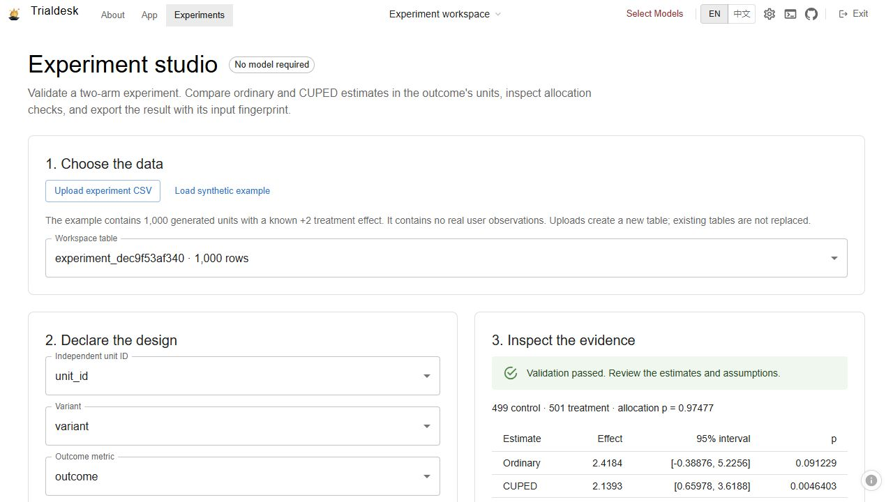

# Trialdesk

A local experiment-analysis studio built on the complete [Microsoft Data Formulator](https://github.com/microsoft/data-formulator) application. Python, Flask, React, TypeScript, Pandas, NumPy and SciPy.

Use an existing workspace table or upload a unit-level CSV. Validate the experiment, compare ordinary and CUPED-adjusted treatment effects, and export a reproducible report. The Experiments workflow needs no model credentials.



## Original additions

- A model-free Experiments route with CSV upload, a bundled synthetic example and explicit design declarations.
- Two-arm validation with unique unit IDs, exact variant labels, finite metrics, complete-row analysis and numerical-range checks.
- Ordinary Welch estimates and one-covariate CUPED using a common pooled coefficient, with approximate 95% intervals.
- An exact-binomial allocation check. Serious sample-ratio mismatch blocks effect results.
- JSON export with the complete specification, method version, assumptions, diagnostics and a SHA-256 fingerprint of the analyzed values.
- Maintained real-application verification and a seeded statistical evaluation.

Data Formulator supplies the underlying application, workspace storage, table loaders, charting, agents, reports and most of this source tree. The fork starts at [`5477f0e`](https://github.com/microsoft/data-formulator/commit/5477f0e236426dc8f74a498ec400414fba7fbc0f). Its [original README](README.upstream.md), MIT license and Microsoft notices are preserved. Live AI workflows were not configured or evaluated for this fork.

## Run locally

Use Python 3.11, Node 24.22.0, Yarn 1.22.22 and uv 0.11.13.

```sh
uv sync --frozen
yarn install --frozen-lockfile
yarn build
uv run --frozen python tools/verify-trialdesk.py demo-001
```

Open the printed loopback URL and select **Experiments**. Create an experiment workspace, then **Load synthetic example** or upload your own CSV. Choose four distinct columns, enter the planned allocation and labels, and confirm the design declarations before **Validate and analyze**.

The helper starts the real app with a new, isolated durable home, external connectors disabled and no model credentials. Use a new run name each time. Enter `cleanup` in its terminal to stop the owned processes. Verification data and evidence remain under ignored `.audit/verification/`. For normal personal workspaces and the inherited features, see [upstream development instructions](DEVELOPMENT.md).

## A concrete example

The included CSV has 1,000 **synthetic** independent units and a known additive treatment effect of +2. Its generated pre-period metric is correlated with the outcome. It contains no real customer observations.

| Estimate | Effect | Approximate 95% interval |
| --- | ---: | --- |
| Ordinary | 2.4184 | [-0.3888, 5.2256] |
| CUPED | 2.1393 | [0.6598, 3.6188] |

These values come from the actual browser export, retained as [example-analysis.json](docs/trialdesk/example-analysis.json). The input fingerprint lets a rerun identify the same selected values. A narrower interval on this example is not a promise about another dataset.

## Research and course connection

The numerical addition implements the single-control-variate mechanism in [Deng, Xu, Kohavi and Walker, *Improving the Sensitivity of Online Controlled Experiments by Utilizing Pre-Experiment Data*, WSDM 2013, section 3.2](https://exp-platform.com/Documents/2013-02-CUPED-ImprovingSensitivityOfControlledExperiments.pdf). One pooled coefficient is applied to both arms. This is a bounded implementation, not a reproduction of Bing's study, ratio-metric extensions or missing-covariate methods.

[Harvard CS109's public capstone](https://cs109.org/pages/projects) provides the data-preparation, statistical-analysis and reproducibility direction. [Stanford CS147's online-test assignment](https://hci.stanford.edu/courses/cs147/2014/wi/assignments/assignment09.html) is an adjacent A/B-testing exercise. Neither is presented as a completed course assignment, credential or real-user study.

## Verification

```sh
yarn test
yarn tsc --noEmit
yarn eslint src/views/ExperimentStudio.tsx
uv run --frozen pytest tests/backend/test_experiments.py tests/backend/routes/test_experiments_api.py -q
uv run --frozen python tools/verify-trialdesk.py http-001 --ci
uv run --frozen python tools/evaluate-cuped.py simulation-001
```

Local acceptance includes 394 frontend tests, root type checking, the production build, bounded component lint and 355 backend/authentication checks. One inherited UserInfo contract is skipped because its fixture has no UserInfo endpoint. The real HTTP driver verifies exact table persistence and identical analysis after app restart. The browser journey covers loading the synthetic CSV, declaration gating, analysis, a real JSON download, result invalidation and allocation-mismatch blocking.

The seeded evaluation executes 500 trials in each of five synthetic Gaussian scenarios, including null effects, negative correlation and unequal allocation. Every trial runs; none is silently excluded. [The retained evaluation](docs/trialdesk/synthetic-evaluation.json) includes bias, Monte Carlo uncertainty, empirical and reported variances, and interval coverage. It is not a guarantee for heavy tails, clustered data or arbitrary observational datasets.

The reusable [verification skill and feature map](.agents/skills/verify-trialdesk/SKILL.md) document the actual product paths and evidence limits.

## Scope and limits

- One independent randomized unit per row, two arms, one pre-treatment covariate and one preselected outcome at a fixed horizon.
- At least 30 units per arm and at most 100,000 rows, without sampling or silently dropping missing selected values. The minimum count does not certify valid asymptotics.
- Covariate timing and randomization are explicit user declarations. The app cannot infer whether a covariate leaked treatment information or whether units interfere.
- CUPED uses approximate plug-in Welch intervals. No sequential monitoring, multiplicity correction, cluster adjustment or observational causal identification is implemented.
- The fingerprint covers the selected columns and unit-sorted values, not the whole source file. Keep the input CSV beside the exported report. Analysis does not store a separate report history.
- New rendered acceptance was performed in the desktop browser. Narrow rendering, cloud deployment and live provider behavior remain unverified.

Dependency updates remove most inherited audit findings. The locked workspace still has a low KaTeX advisory and Python findings in oauthlib and thrift. Databricks constrains those Python dependencies below the advertised patched versions. See [method, API and dependency details](TRIALDESK.md). This local development fork is not an audited multi-user deployment. Inherited generated-Python execution is not a hostile-code security boundary.

## License

[MIT](LICENSE), with original Microsoft and dependency notices retained.
