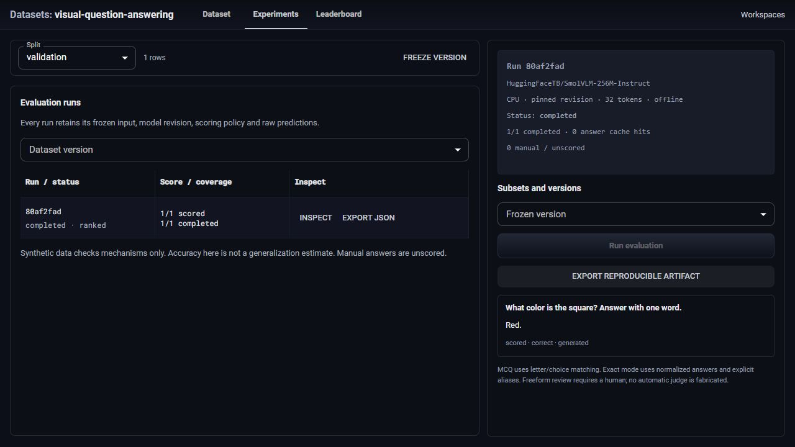

# Visual question answering evaluation

A local dataset annotation and multimodal evaluation workspace built on the full [Trialdesk](README.trialdesk.md) and [Microsoft Data Formulator](README.upstream.md) applications. The inherited workspace, identity, table loaders, charting, agents and experiment analysis remain available. This extension adds `/vqa` for owned images and an actual offline vision model.

Annotate a PNG/JPEG with a question, context, answer mode and gold answer. Freeze a train, validation or test split into an immutable SHA-256 manifest. Evaluate a pinned local SmolVLM model, inspect raw predictions, compare runs from the same version and scorer, and export the manifest, images, predictions, cache keys and model-file checksums as JSON.



See the [dataset view](docs/vqa/dataset-desktop.png) and [390px annotation inspector](docs/vqa/inspector-narrow.png). These screenshots show mechanism checks on synthetic content, not a model-quality evaluation.

## Run the application

Use Python 3.11, Node 24, Yarn 1.22.22 and uv 0.11.13.

```sh
uv sync --frozen
yarn install --frozen-lockfile
yarn build
uv run --frozen python -m data_formulator --host 127.0.0.1 --port 8432 --disable-data-connectors --disable-custom-models --disable-display-keys
```

Open `http://127.0.0.1:8432/vqa`. Create a VQA workspace or select an existing workspace through Workspaces. Upload your own raster image, enter a question and answer, then save. Freeze the selected split. Experiments starts runs and displays predictions; Leaderboard compares one frozen version. The UI does not download weights or request model credentials.

## Configure the real local model

The optional explicit download command fetches only the allowlisted safetensors, processor/tokenizer/config and model card files for [HuggingFaceTB/SmolVLM-256M-Instruct](https://huggingface.co/HuggingFaceTB/SmolVLM-256M-Instruct), Apache-2.0, revision `7e3e67edbbed1bf9888184d9df282b700a323964`.

```sh
uv run --frozen python tools/download-vqa-model.py
```

Weights remain ignored in `.tooling/smolvlm/`. The downloader records source URLs, sizes and SHA-256 hashes in `download-manifest.json` before application use. The 513,028,808-byte model file has SHA-256 `74dea5904032e5ae99a2e0eef5179e6ac0f1dedc3ab0c7c2a5d4d387c843203e`. No pickle weights, remote Python, ONNX variants or dataset photographs are downloaded.

Set `VQA_MODEL_PATH` to that absolute cache directory and `VQA_MODEL_PYTHON` to an explicitly provisioned Python interpreter with PyTorch 2.11, Transformers 5.20.2, safetensors 0.8.0, Pillow 13.0.0 and torchvision 0.26.0. `VQA_VISION_PACKAGES` optionally selects a project-local Pillow/torchvision package directory. The implementation was exercised with CPU inference and that exact combination. It never installs or mutates the configured interpreter. Core application dependencies are locked separately by uv.

The application verifies every model-file checksum, starts a bounded separate CPU process, sets offline flags and uses `local_files_only=True`, `trust_remote_code=False` and safetensors. A missing or broken model creates a visible failed run. There is no mock fallback. The processor uses its pinned image-splitting defaults; each generated result records pixel tensor shape and observed vision-encoder forward count.

## Evaluation semantics

- MCQ accepts an exact choice, a letter or a consistent letter plus choice. It rejects ambiguous prose. Exact mode case-folds, trims whitespace and terminal `.?!`, and compares the gold answer or explicit aliases.
- Manual mode retains the prediction with `manual_required`; it does not invent a judge score. No Gemini, paid API or automatic subjective judge is configured.
- Answer cache keys include canonical image bytes, question, context, choices, answer mode, model revision/files, prompt version and generation configuration. Gold is excluded from model input. Score keys separately include the prediction, annotation revision and scorer version. Editing gold reuses answers and recomputes scores; editing the question invalidates answers.
- A version captures the whole canonical split. Future edits never mutate it. Runs record their exact version, model files, generation/scorer versions, timestamps, cache decisions, terminal state and partial results.
- Only completed runs with every item mechanically scored are rankable. Leaderboard comparisons are restricted to the same manifest and scorer. Failed, cancelled, partial and manual-containing runs remain visible and unranked.

One local evaluator runs at a time, with no unbounded queue and a 600-second process limit. Requests are bounded to 3 MB, input images to 2 MB, 2048 pixels per side and two million pixels. Only single-frame decoded PNG/JPEG is accepted and re-encoded as RGB PNG. A workspace holds at most 64 annotations, 128 versions, 256 runs and 128 MB of image bytes. SQLite transactions preserve cancellation flags across worker updates, including fully cached runs. Emitted predictions are ingested during generation and committed individually. Cancellation stops the owned model process tree before temporary-file cleanup, including Windows virtualenv descendants. A restarted application marks unfinished runs failed and retains their saved partial results.

If process cleanup itself fails, the failed run records the owned PID and that it may still be alive. New evaluations remain explicitly blocked even though worker bookkeeping is released. Confirm that owned process cleanup has completed before restarting the application; a failed cleanup is not reported as successful cancellation.

VQA routes use the existing identity and workspace manager and require an existing owned local/ephemeral workspace. They accept no filesystem paths, remote image URLs, archives or executable code. This is a single-process local tool; inherited Data Formulator agent execution is not a hostile-code sandbox. The inherited dependency audit exceptions remain documented in [TRIALDESK.md](TRIALDESK.md).

## Verification

```sh
uv run --frozen pytest tests/backend/test_vqa.py -q
yarn test
yarn tsc --noEmit
node node_modules/eslint/bin/eslint.js src/views/VqaStudio.tsx
yarn build
uv run --frozen python tools/verify-vqa.py unique-run-001 --ci --port 8432
```

The maintained [verification skill](.agents/skills/verify-vqa/SKILL.md) drives the real HTTP app in an isolated home, including inherited table/experiment behavior, annotation, immutable revisions, real generation when configured, gold/question cache invalidation, ranked versus manual results, cancellation, JSON export, restart persistence and owned cleanup. Without explicit model configuration it proves visible failure and records `real_model: false`; that is not real inference proof. Evidence survives under ignored `.audit/verification/<run>/`. Tests assert deterministic schemas, cache keys and scoring rules; they do not assert generated wording. Browser verification uses CUA and is distinct from HTTP proof.

Owned synthetic shape/color/text images exercise mechanisms. Their scores do not establish model accuracy, generalization, GPU performance or course completion.

## Sources and attribution

This new implementation follows the canonical question/context/images/choices/answer/answer-label/answer-mode schema and mode-aware scoring separation described in Berkeley's [VQA Studio final report](https://people.eecs.berkeley.edu/~kubitron/courses/cs262a-F25/projects/reports/project1001_paper_ver2_47739557327740883388.pdf). Student repositories were not copied. The local model, immutable annotation platform and answer/score cache mechanism are extension work, not claims that the paper shipped this interface.

The repository preserves full Trialdesk history at `2069fef66bd874d7f1b69e29dde9d728aae419af`, the complete Microsoft Data Formulator ancestor at `5477f0e236426dc8f74a498ec400414fba7fbc0f`, the MIT license, Microsoft notices and both prior READMEs. Visual structure follows the inspected [Hugging Face dataset viewer](https://huggingface.co/datasets/merve/vqav2-small/viewer/default/validation); source and required adaptations are recorded in [.agents/design-reference.md](.agents/design-reference.md). No Hugging Face branding or source code is copied.

Inherited Python publish, desktop release and Trialdesk workflows are preserved byte for byte in inactive [.github/upstream-workflows/](.github/upstream-workflows/). Only the read-only VQA verification workflow remains active; no publication or release workflow is enabled for this extension.
