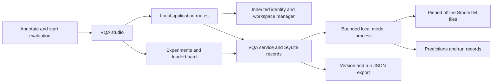
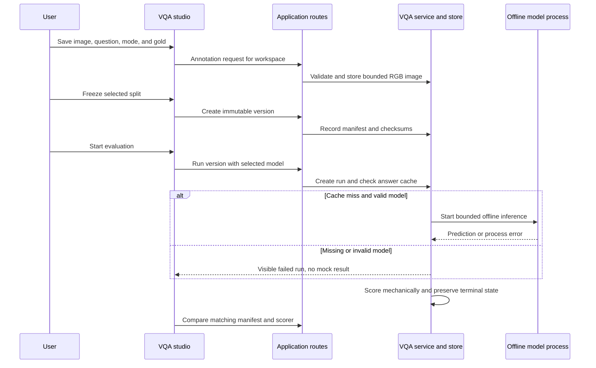

# Visual question answering evaluation

## Guide

- [Architecture and execution guide](#architecture-and-execution-guide)
- [Run the application](#run-the-application)
- [Configure the real local model](#configure-the-real-local-model)
- [Evaluation semantics](#evaluation-semantics)
- [Verification](#verification)
- [Sources and attribution](#sources-and-attribution)

The [answer-cache comparison](docs/cache-impact-20261024.md) completed five alternating timed pairs through the real application. Repeating three synthetic image questions took **0.453 seconds median with cached answers versus 47.094 seconds uncached**, avoiding all three inferences and model-process startup while preserving cached predictions, scores, and provenance. These are developer-host workflow measurements, not a model-inference speedup or general accuracy result.

The [ScienceQA held-out test results](docs/benchmark-results-20261022.md) retain five uncached CPU repeats on 128 fixed test questions: all 640 image evaluations completed, with 77/128 correct in each repeat. This is a narrow result for the pinned image-bearing ScienceQA subset, not a general VQA score. The [ScienceQA validation results](docs/validation-results.md) retain five uncached CPU repeats on 16 fixed validation questions: all 80 image evaluations completed, median 264.91 seconds per 16 items and model peak RSS 3.460–3.521 GiB. Original scoring was 1/16; a deterministic `Answer: C` parser correction re-scores the same saved predictions to 12/16, with the original evidence preserved. A separate eight-item native CPU profile passed, retaining operator/shape/memory evidence without changing model settings; its instrumented timings are excluded from runtime comparisons. Follow the [frozen plan](docs/benchmark-plan.md) and start with `uv run --frozen python tools/verify-trialdesk.py benchmark-smoke --ci --port 8432 --benchmark-vqa smoke`. Official ScienceQA data is CC BY-NC-SA 4.0 and stays outside Git.

A local dataset annotation and multimodal evaluation workspace built on the full [Trialdesk](README.trialdesk.md) and [Microsoft Data Formulator](README.upstream.md) applications. The inherited workspace, identity, table loaders, charting, agents and experiment analysis remain available. This extension adds `/vqa` for owned images and an actual offline vision model.

Annotate a PNG/JPEG with a question, context, answer mode and gold answer. Freeze a train, validation or test split into an immutable SHA-256 manifest. Evaluate a pinned local SmolVLM model, inspect raw predictions, compare runs from the same version and scorer, and export the manifest, images, predictions, cache keys and model-file checksums as JSON.


See the [dataset view](docs/vqa/dataset-desktop.png) and [390px annotation inspector](docs/vqa/inspector-narrow.png). These screenshots show mechanism checks on synthetic content, not a model-quality evaluation.

## Run the application

Use Python 3.11, Node 24, Yarn 1.22.22 and uv 0.11.13.

```sh
uv sync --frozen
yarn install --frozen-lockfile
yarn build
uv run --frozen python -m data_formulator --host 127.0.0.1 --port 8432 --disable-data-connectors --disable-custom-models --disable-display-keys
```

Open `http://127.0.0.1:8432/vqa`. Create a VQA workspace or select an existing workspace through Workspaces. Upload your own raster image, enter a question and answer, then save. Freeze the selected split. Experiments starts runs and displays predictions; Leaderboard compares one frozen version. The UI does not download weights or request model credentials.

## Configure the real local model

The optional explicit download command fetches only the allowlisted safetensors, processor/tokenizer/config and model card files for [HuggingFaceTB/SmolVLM-256M-Instruct](https://huggingface.co/HuggingFaceTB/SmolVLM-256M-Instruct), Apache-2.0, revision `7e3e67edbbed1bf9888184d9df282b700a323964`.

```sh
uv run --frozen python tools/download-vqa-model.py
```

Weights remain ignored in `.tooling/smolvlm/`. The downloader records source URLs, sizes and SHA-256 hashes in `download-manifest.json` before application use. The 513,028,808-byte model file has SHA-256 `74dea5904032e5ae99a2e0eef5179e6ac0f1dedc3ab0c7c2a5d4d387c843203e`. No pickle weights, remote Python, ONNX variants or dataset photographs are downloaded.

Set `VQA_MODEL_PATH` to that absolute cache directory and `VQA_MODEL_PYTHON` to an explicitly provisioned Python interpreter with PyTorch 2.11, Transformers 5.20.2, safetensors 0.8.0, Pillow 13.0.0 and torchvision 0.26.0. `VQA_VISION_PACKAGES` optionally selects a project-local Pillow/torchvision package directory. The implementation was exercised with CPU inference and that exact combination. It never installs or mutates the configured interpreter. Core application dependencies are locked separately by uv.

The application verifies every model-file checksum, starts a bounded separate CPU process, sets offline flags and uses `local_files_only=True`, `trust_remote_code=False` and safetensors. A missing or broken model creates a visible failed run. There is no mock fallback. The processor uses its pinned image-splitting defaults; each generated result records pixel tensor shape and observed vision-encoder forward count.

## Evaluation semantics

- MCQ accepts an exact choice, a letter, an explicit `Answer: C` letter or a consistent letter plus choice. Scorer `mode-exact-v3` rejects ambiguous prose and out-of-range choices; earlier runs retain their original scorer and scores. Exact mode case-folds, trims whitespace and terminal `.?!`, and compares the gold answer or explicit aliases.
- Manual mode retains the prediction with `manual_required`; it does not invent a judge score. No Gemini, paid API or automatic subjective judge is configured.
- Answer cache keys include canonical image bytes, question, context, choices, answer mode, model revision/files, prompt version and generation configuration. Gold is excluded from model input. Score keys separately include the prediction, annotation revision and scorer version. Editing gold reuses answers and recomputes scores; editing the question invalidates answers.
- A version captures the whole canonical split. Future edits never mutate it. Runs record their exact version, model files, generation/scorer versions, timestamps, cache decisions, terminal state and partial results.
- Only completed runs with every item mechanically scored are rankable. Leaderboard comparisons are restricted to the same manifest and scorer. Failed, cancelled, partial and manual-containing runs remain visible and unranked.

One local evaluator runs at a time, with no unbounded queue and a 600-second process limit. Requests are bounded to 3 MB, input images to 2 MB, 2048 pixels per side and two million pixels. Only single-frame decoded PNG/JPEG is accepted and re-encoded as RGB PNG. A workspace holds at most 64 annotations, 128 versions, 256 runs and 128 MB of image bytes. SQLite transactions preserve cancellation flags across worker updates, including fully cached runs. Emitted predictions are ingested during generation and committed individually. Cancellation stops the owned model process tree before temporary-file cleanup, including Windows virtualenv descendants. A restarted application marks unfinished runs failed and retains their saved partial results.

If process cleanup itself fails, the failed run records the owned PID and that it may still be alive. New evaluations remain explicitly blocked even though worker bookkeeping is released. Confirm that owned process cleanup has completed before restarting the application; a failed cleanup is not reported as successful cancellation.

VQA routes use the existing identity and workspace manager and require an existing owned local/ephemeral workspace. They accept no filesystem paths, remote image URLs, archives or executable code. This is a single-process local tool; inherited Data Formulator agent execution is not a hostile-code sandbox. The inherited dependency audit exceptions remain documented in [TRIALDESK.md](TRIALDESK.md).

## Verification

```sh
uv run --frozen pytest tests/backend/test_vqa.py -q
yarn test
yarn tsc --noEmit
node node_modules/eslint/bin/eslint.js src/views/VqaStudio.tsx
yarn build
uv run --frozen python tools/verify-vqa.py unique-run-001 --ci --port 8432
```

The maintained [verification skill](.agents/skills/verify-vqa/SKILL.md) drives the real HTTP app in an isolated home, including inherited table/experiment behavior, annotation, immutable revisions, real generation when configured, gold/question cache invalidation, ranked versus manual results, cancellation, JSON export, restart persistence and owned cleanup. Without explicit model configuration it proves visible failure and records `real_model: false`; that is not real inference proof. Evidence survives under ignored `.audit/verification/<run>/`. Tests assert deterministic schemas, cache keys and scoring rules; they do not assert generated wording. Browser verification uses CUA and is distinct from HTTP proof.

Owned synthetic shape/color/text images exercise mechanisms. Their scores do not establish model accuracy, generalization, GPU performance or course completion.

## Sources and attribution

This new implementation follows the canonical question/context/images/choices/answer/answer-label/answer-mode schema and mode-aware scoring separation described in Berkeley's [VQA Studio final report](https://people.eecs.berkeley.edu/~kubitron/courses/cs262a-F25/projects/reports/project1001_paper_ver2_47739557327740883388.pdf). Student repositories were not copied. The local model, immutable annotation platform and answer/score cache mechanism are extension work, not claims that the paper shipped this interface.

The repository preserves full Trialdesk history at `2069fef66bd874d7f1b69e29dde9d728aae419af`, the complete Microsoft Data Formulator ancestor at `5477f0e236426dc8f74a498ec400414fba7fbc0f`, the MIT license, Microsoft notices and both prior READMEs. Visual structure follows the inspected [Hugging Face dataset viewer](https://huggingface.co/datasets/merve/vqav2-small/viewer/default/validation); source and required adaptations are recorded in [.agents/design-reference.md](.agents/design-reference.md). No Hugging Face branding or source code is copied.

Inherited Python publish, desktop release and Trialdesk workflows are preserved byte for byte in inactive [.github/upstream-workflows/](.github/upstream-workflows/). Only the read-only VQA verification workflow remains active; no publication or release workflow is enabled for this extension.

## Architecture and execution guide

This repository preserves the complete Trialdesk and Microsoft Data Formulator applications. The VQA extension adds annotation, immutable split versions, local image inference, scoring, caches, comparisons, and export. It uses inherited workspace and identity services and an optional separately provisioned SmolVLM runtime; it does not replace inherited charting or agents. A [manifest](#manifest) pins the evaluation input.

The UI calls the local application API. The backend owns VQA records and run lifecycle; inference runs in a bounded child process with explicitly configured model files.



Workspace selection gates access. The service validates uploads and frozen versions, then records predictions and final state. The [answer cache](#answer-cache) and [score cache](#score-cache) have separate provenance; [offline inference](#offline-inference) reads configured local files. Partial or failed evaluations remain visible, as do outputs marked [manual_required](#manual-required), but these cannot enter the leaderboard. Each run points to an [immutable version](#immutable-version).



| Subsystem | Responsibility and owned state | Source |
|---|---|---|
| VQA screen | Annotation, split selection, run state, leaderboard, export actions | [`VqaStudio.tsx`](src/views/VqaStudio.tsx) |
| Routes and validation | Workspace access, request bounds, image and run input validation | [`vqa.py`](py-src/data_formulator/routes/vqa.py) |
| Dataset and version store | Annotation revisions and immutable split snapshots | [`vqa.py`](py-src/data_formulator/vqa.py), [`backend tests`](tests/backend/test_vqa.py) |
| Model process | Offline inference and bounded child lifecycle | [`vqa_runner.py`](py-src/data_formulator/vqa_runner.py), [`vqa_execution.py`](py-src/data_formulator/vqa_execution.py) |
| Evaluation and caches | Prediction, mechanical score, cache provenance, rank eligibility | [`VQA test suite`](tests/backend/test_vqa.py) |

### Evaluation journey

1. Select an owned local workspace and add a PNG or JPEG, question, answer mode, and gold answer.
2. Freeze a split. Its manifest pins annotation revisions; later edits create a different [immutable version](#immutable-version).
3. Start a run. On an answer-cache miss, the service starts the configured offline model process; it never downloads weights or uses a mock fallback.
4. The service records predictions and mechanical scores. Manual answers remain `manual_required` and are not leaderboard-rankable.
5. Compare only runs with matching manifest and scorer, or export the run. Cancellation and process failures preserve partial results and terminal state.

### Design decisions and tradeoffs

These rationales are inferred from the implementation.

| Choice | Practical reason | Alternative and cost to reconsider |
|---|---|---|
| Freeze datasets into immutable manifests | A run identifies the exact annotation revisions it evaluated | Evaluate mutable rows, so later edits change the apparent inputs |
| Keep answer and score caches separate | Gold changes can rescore without repeating inference | Combine caches, coupling scoring changes to inference |
| Use a local offline model process | Images and weights stay in the local workflow with bounded child lifecycle | Hosted inference adds network, credentials, and external data handling |
| Require mechanical scores for ranking | Manual judgments and partial runs cannot look numerically comparable | Rank subjective or partial outputs, weakening comparison meaning |
| Reuse inherited workspaces and identity | Existing access behavior remains the workspace boundary | Build a separate app and duplicate those systems |

### Glossary

<a id="immutable-version"></a>

<details><summary>What is an immutable version?</summary>

It records a fixed set of annotation revisions. Runs point to that snapshot even when the workspace changes later.

</details>

<a id="manifest"></a>

<details><summary>What is a manifest?</summary>

A manifest lists frozen evaluation items and content hashes. This project uses SHA-256 to identify the exact split of a run.

</details>

<a id="answer-cache"></a>

<details><summary>What is the answer cache?</summary>

It reuses a prediction when image, prompt inputs, model revision, and generation settings match. Gold is excluded, so changing gold does not require inference.

</details>

<a id="score-cache"></a>

<details><summary>What is the score cache?</summary>

It stores mechanical scoring separately from generated answers. A gold or scorer revision can change the score while retaining the prediction.

</details>

<a id="manual-required"></a>

<details><summary>What does manual_required mean?</summary>

It marks an answer with no configured objective scoring rule. It remains visible, but the run cannot be ranked.

</details>

<a id="offline-inference"></a>

<details><summary>What is offline inference?</summary>

It uses files already present and blocks remote model loading. Missing or invalid files produce failure rather than a download or invented output.

</details>
