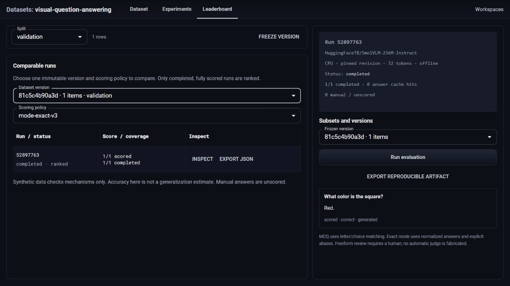

# Comparison by scoring policy

The leaderboard previously filtered every run against `mode-exact-v2`, while new backend evaluations used `mode-exact-v3`. New completed runs were absent from comparison. The studio now selects the frozen dataset version and scoring policy separately. Scores from different policies remain in separate comparison groups.

A focused component regression reproduced the missing policy selector before the fix. The test now switches between v2 and v3 and checks that only the selected group appears. The three focused frontend tests, TypeScript, scoped ESLint, 40 VQA backend tests and Node 24 production build passed locally.

The real application evaluated an owned synthetic red-square image with the pinned `HuggingFaceTB/SmolVLM-256M-Instruct` revision `7e3e67edbbed1bf9888184d9df282b700a323964`. The production preflight checked all 13 model files. Run `5289776302d84979b411982ef2f6f01a` completed one uncached vision forward, produced a mechanically correct answer, and appeared as completed and ranked under `mode-exact-v3` for frozen version `81c5c4b90a3d...`.

The main agent selected the workspace, version and leaderboard through CUA, then exported the run through its real browser button. The browser export matched the HTTP export as parsed JSON, including predictions and provenance. Its SHA-256 was `0a497c9c5f4557510b64ed241f9bbea14ce8b920df84a73ea47af88437d42470`. After the production app restarted, the same run and export remained available. The isolated server was stopped and its evidence retained.

The final screenshot was inspected at a measured 1280 by 720 CSS viewport. The new policy control uses the existing MUI pattern with a 12-pixel gap, keeping its floating label clear of the version control. The dataset view retains the established two-column layout. The temporary viewport was reset after the check.

This single synthetic example checks the evaluation, comparison, export and persistence workflow. It is not a held-out model-quality result, speedup measurement, or benchmark of general visual understanding. Existing held-out and cache measurements retain their separate documented protocols.
